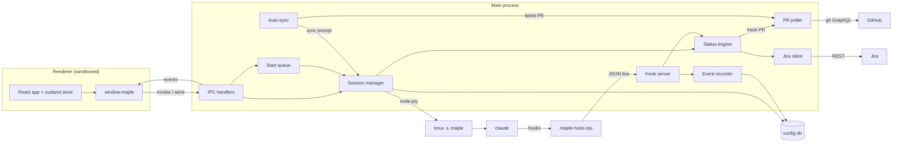
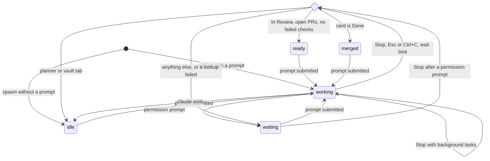

# Maple Architecture

How Maple's parts fit together, and the words we use for them. The README covers setup, config fields, and the
security model; this page covers what happens inside.

## Processes

Maple is one Electron app that drives Claude sessions running in tmux.

- **Main process** (Node). `src/main/index.ts` wires everything at launch: config, saved state, the hook server, the
  session manager, the status engine, the pollers, and the IPC handlers. Code lives in topic folders under `src/main/`.
- **Renderer** (browser, sandboxed). `src/renderer/src/App.tsx` draws the Home tab and the open tabs. App state lives
  in one zustand store, `src/renderer/src/store.ts`. The renderer cannot touch Node, files, or the network.
- **Preload bridge.** `src/preload/index.ts` builds `window.maple` from the shared channel table and is the renderer's
  only way to reach the main process.
- **tmux.** One tmux server, `tmux -L maple`, holds one tmux session `maple-<tabId>` per tab. Each runs `claude`. The
  main process attaches to it through `node-pty` and streams the terminal to the renderer.
- **Shell terminals.** A card tab can also open plain shells (`src/main/sessions/Terminals.ts`). They run through
  `node-pty` outside tmux, back the `terminal` IPC area, and close on quit.
- **Hook script.** Claude runs `resources/maple-hook.mjs` on each hook. It sends one JSON line to Maple's hook socket.
- **Outside tools.** `git` and `gh` run as child processes with argument arrays and timeouts. Jira is called over REST
  by one client, `src/main/jira/JiraClient.ts`. `src/shared/` holds types and pure helpers both sides import.



## IPC Surface

`window.maple` has twelve areas: `config`, `preflight`, `jira`, `tabs`, `session`, `terminal`, `repo`, `vault`,
`learning`, `pr`, `findings`, and `app`. `src/shared/api/mapleApi.ts` declares them as the `MapleApi` type and the
`IPC_CHANNELS` table. Each area has one API file in `src/shared/api/` (for example `src/shared/api/session.ts`) and
one handler file in `src/main/ipc/` (for example `src/main/ipc/session.ts`).

Every method is one of three channel kinds:

- `invoke`: the renderer asks and awaits an answer. The main process registers it with `handle`
  (`src/main/ipc/handle.ts`) on channel `<area>:<method>`.
- `send`: the renderer fires and forgets, such as keystrokes. Registered with `on` (`src/main/ipc/on.ts`).
- `event`: the main process pushes to the renderer with `emit` (`src/main/ipc/emit.ts`). A method named `onData`
  becomes channel `<area>:data`, plus any keys such as a tab id (`src/shared/api/eventChannel.ts`).

`handle` and `on` check every argument against a zod schema before the handler runs; a bad `invoke` throws and a bad
`send` is dropped. Accepted calls on a fixed list of channels, such as starting, closing, and prompting a tab, are
also recorded in the event log as UI actions (`src/main/events/uiActions.ts`). See the README's Security
Model for what the main process will and won't do for the renderer.

## Session Lifecycle

A **tab** is a saved record (`TabState`); a **session** is the Claude conversation running in it. The session manager,
`src/main/sessions/SessionManager.ts`, owns both and splits the work across `src/main/sessions/manager/`: the tab
registry, the Claude processes, the worktree tracker, and the tab saver.

**Opening.** Starting a card runs, inside `tmux new-session -A` in the project's `plannerDir` (vault and learning tabs
use `vaultDir`):

```text
claude --dangerously-skip-permissions --settings <config dir>/hooksFile.json \
  --session-id <new uuid> | --resume <id>  [prompt]
```

A new card gets `--session-id` with a fresh uuid and the card prompt. Reopening a card whose session was closed passes
`--resume <id>` with no prompt, but only when a transcript for that id exists under `~/.claude/projects`; otherwise
Maple logs `no transcript, starting fresh` and starts a new session with the same id. The tmux session's environment
carries `MAPLE_TAB_ID`, `MAPLE_SOCKET`, and, for card tabs, `MAPLE_SNAPSHOT_DIR`, `MAPLE_VAULT_DIR`, and
`MAPLE_FINDINGS_DIR`. The process environment also carries the Jira credentials so Claude can call Jira.

**Hooks.** `hooksFile.json` registers `maple-hook.mjs` for `Stop`, `UserPromptSubmit`, `SessionStart`, `Notification`
(permission prompts only), and `PreToolUse` (file writes and vault note writes only). It also adds the findings dir
to `sandbox.filesystem.allowWrite`, so the `/card` skill's script can write findings from Bash. `PreToolUse` sends
nothing; it copies the vault note about to change into the snapshot dir. Every other hook sends one JSON line (tab
id, event, notification type, background tasks, cron count, session id) to the hook socket. The hook server,
`src/main/sessions/hooks/hookServer.ts`, validates each line and hands it to the status engine, the event recorder,
and PR events.

**Worktrees.** For each card tab the worktree tracker watches `worktreesDir` for folders named after the card key. A
card may have several worktrees; the tab keeps one selected.

**Closing.** Closing a tab kills its tmux session and remembers the card's session id in `closedSessions`. Opening the
same card later resumes that session.

**Quitting** stops the pollers and the start queue, kills the tmux server, closes the shell terminals, and waits up to
two seconds for the event recorder to finish writing.

**Launch.** Maple loads `config.json` and `state.json`, then `src/main/sessions/restore.ts` reopens every saved tab with
its session id, so each one resumes. A tab whose project is gone from config is dropped with a warning. A tab that
fails to open is kept in `state.json` for the next launch. If config is missing at launch, restore waits until the
user saves it.

**Start queue.** Every Start goes through `src/main/sessions/StartQueue.ts`, shared by all projects. A card starts at
once when nothing is queued and the limits allow; otherwise it waits in the queue, saved in `state.json`. A queued
card waits for `room` (`maxWorking` tabs already working), `cpu` (load per core over `maxLoadPerCore`), `memory`
(free memory under `minFreeMegabytes`), or `pace` (less than `startGapSeconds` since the last start, once
`startAtOnce` tabs are working or other cards are already queued).

## Status Dot

Each tab has one status dot. `nextDot` in `src/shared/status/dots.ts` maps an input to a dot, and `StatusEngine` in
`src/main/sessions/StatusEngine.ts` feeds it inputs and emits each change. The on-screen labels come from `DOT_LABELS`.

| State     | On screen        | Meaning                                                              |
| --------- | ---------------- | -------------------------------------------------------------------- |
| `working` | Working          | Claude is running a turn or waiting on background tasks.             |
| `waiting` | Needs you        | Claude stopped and the card is not ready for review.                 |
| `ready`   | Ready for review | Card is In Review with an open PR, and no open PR has failed checks. |
| `merged`  | Merged           | Card is Done.                                                        |
| `idle`    | Idle             | No turn has run, Claude exited mid-turn, or a planner stopped.       |



The inputs:

- **Spawn** with a prompt is `working`; without one, `idle`.
- **UserPromptSubmit** is `working`.
- **Permission prompt** (a `Notification` hook) is `waiting`.
- **Stop with background tasks** stays `working`. `src/main/sessions/backgroundWait.ts` sorts the task kinds: a
  subagent or workflow waits until the next Stop; a shell task or a session cron waits at most
  `backgroundWaitMinutes`, then runs the Stop check.
- **Stop check.** A Stop hook runs it from any dot, not only `working`. Planner, vault, and learning tabs go to
  `idle`. A card tab looks up the card in Jira and its PRs from the PR poller, waiting for a fresh poll, with a 15 s
  timeout each. Done is `merged`; In Review with at least one open PR and no failed checks on any open PR is `ready`;
  anything else, or a failed lookup, is `waiting`.
- **Esc or Ctrl+C** typed while `working` (and not waiting on background tasks) runs the Stop check.
- **Claude exits:** `working` becomes `idle`; other dots stay. A non-zero exit within 5 s of a resume marks the
  resume failed.
- **Resumed tab:** a card tab spawned with `--resume` gets its dot from Jira and its PRs, like a Stop check, but keeps
  `idle` if the lookup fails. A new tab spawned without a prompt only changes, to `merged`, when its card is Done.

Separate from the dot, each tab has a **sync state** set by auto-sync: `queued` while a merge-main prompt waits for the
tab to stop working, and `syncing` while Claude runs it. It clears when that turn ends, the session exits, or the
user switches away while it is still `queued`.

## Pollers

- **PR poller** (`src/main/github/PrPoller.ts`): every 60 s, and again whenever a dot settles, one batched `gh`
  GraphQL call fetches the PR for every worktree of every card tab. It is the only source of PR data: the status
  engine asks it for a fresh result, and auto-sync and the `pr` IPC area read its latest result.
- **Auto-sync** (`src/main/sessions/AutoSync.ts`): every 120 s, and when the active tab changes, it checks the active
  tab only. If the card is In Review and an open PR conflicts with main, it queues a prompt asking Claude to merge
  main, once per PR head.
- **Start queue recheck**: every 15 s, plus on every dot change and tab change, the start queue retries queued cards.
- **Worktree watcher** (`src/main/git/worktreeWatcher.ts`): file-system watches, debounced 300 ms, on `worktreesDir`
  (to find a card's worktrees), on the shown worktree (to refresh its file changes), on the vault, and on the
  findings dir. The vault watch (`src/main/vault/vaultWatcher.ts`) is shared by the `vault` and `learning` IPC areas
  and sends `vault.onChanged`. A findings change sends `findings:changed`, and the card tab re-reads its file. It
  watches the folder, not the file, because writers replace the file by renaming a temp file over it.
- **Renderer refreshes**, each every 60 s: the sprint board (`src/renderer/src/home/useSprint.ts`), the backlog
  (`src/renderer/src/home/backlog/useBacklog.ts`), and the active card tab's card, PR, changes, and cost
  (`src/renderer/src/card/useCardData.ts`).

## Config Dir

`MAPLE_CONFIG_DIR`, default `~/.config/maple`, holds:

- `config.json`: user config, read by `src/main/app/config/config.ts`. See the README's Config section.
- `state.json`: a format `version`, open tabs, closed sessions, the start queue, the notifications toggle, zoom,
  the last chosen project, and seen dots (`src/main/app/state/state.ts`).
- `state.json.1` to `.N`: launch backups, newest first, `stateBackups` kept (`src/main/app/state/backupState.ts`).
- `state.json.corrupt`: an unreadable `state.json`, moved aside at launch.
- `hooksFile.json`: Claude settings that register the hooks; rewritten each launch.
- `tmux.conf`: config for the `maple` tmux server; rewritten each launch.
- `maple.sock`: the hook socket. It lives in `XDG_RUNTIME_DIR` instead when that is set and `MAPLE_CONFIG_DIR` is
  not.
- `logs/main.log`: the main process log with secrets scrubbed (`src/main/app/log/log.ts`).
- `events/<YYYY-MM-DD>.jsonl`: the event log, one file per local day (`src/main/events/eventLog.ts`).
- `snapshots/<sessionId>/`: vault notes as they were before a card session first wrote them
  (`src/main/vault/snapshots.ts`).
- `findings/<KEY>.json`: each card's security findings, in the shape the vault note
  `Projects/Maple/Findings Contract.md` gives. Maple creates the folder at launch and reads each file with
  `src/main/findings/readFindings.ts`; a missing file means no findings, and a newer or invalid file shows an error
  in the card's Findings tab. Taylor's decisions and severity overrides are written back to the same file by
  `src/main/findings/saveFindings.ts`, which writes a temp file and renames it over the old one.
- `decisions/<KEY>.json`: Maple's own record of Taylor's decisions and severity overrides, kept outside the findings
  folder that sessions can write (`src/main/findings/decisions/`). Maple shows a decision or override only when this
  record holds it for the same finding id and identity, so one a session writes into a findings file is ignored.
- `electron/`: Electron's own data, only when `MAPLE_CONFIG_DIR` is set.

`config.json` and `state.json` each carry a format `version`; a file without one counts as version 1. `state.json` is
at version 2, which added the `learning` tab kind; version 1 files load unchanged. At load,
`src/main/util/upgrade.ts` upgrades an older file one version at a time. A `config.json` from a newer Maple is
shown as a config error. A `state.json` from a newer Maple stays in place: Maple starts with no tabs, shows a notice
naming the file, and does not save state that run.

Outside it: the Jira credentials file at `MAPLE_JIRA_ENV` (default `~/.config/jira/env`), shared with other tools, and
`.maple-try/` in the repo, the throwaway config dir `make try` uses, which also gets its own tmux server.

## Glossary

Terms are sorted A to Z. Dot states use the code's names, with the on-screen label beside them.

- **Auto-sync**: Maple's check that the active card tab's open PR conflicts with main, after which it asks Claude to
  merge main. See sync state.
- **Card**: a Jira issue, such as `MPL-277`. A card tab runs one Claude session for one card.
- **Event log**: one JSON line per event (session spawn and exit, hooks, dot changes, PR and review events, UI
  actions) in `events/`, kept as a record of what happened.
- **Home**: the first tab, with the sprint board, the backlog, the start queue, and the planner. It has no session of
  its own.
- **Hook**: a command Claude runs on an event such as Stop. Maple's hook script reports each one to the hook socket.
- **Hook socket**: the Unix socket, `maple.sock`, the hook server listens on.
- **`idle`** (Idle): no turn has run since spawn, Claude exited mid-turn, or a planner, vault, or learning turn ended.
- **Learning**: the pinned tab after Vault, shown when `vaultDir` is set. It lists the lesson notes in
  `Learning/Security/`, one per kind of vulnerability, with their to-learn, learned, and comfortable states, and runs
  its own Claude session in the vault. It is a tab of kind `learning`, one per project.
- **Lesson note**: a vault note at `Learning/Security/<class>.md` whose frontmatter holds `status`, `comfortable`, and
  quiz `grades`; Maple's `learning` IPC area lists them and sets `comfortable`.
- **`merged`** (Merged): the card is Done.
- **Planner**: a project's Claude session in its `plannerDir`, shown in the Home tab's planner pane, for planning and
  suggesting batches of cards to start. It is a tab of kind `planner`.
- **PR poller**: the one place PR data comes from; see Pollers.
- **Project**: one entry in `config.json`, tied to a Jira project key, a `plannerDir`, and GitHub repos.
- **`ready`** (Ready for review): the card is In Review with at least one open PR, and no open PR has failed checks.
- **Session**: one Claude conversation. Its session id survives closing the tab, so reopening the card resumes it.
- **Snapshot**: a copy of a vault note taken before a card session first changes it, so Maple can show the diff.
- **Start queue**: cards waiting to start until the working, load, memory, and pace limits allow.
- **Status dot**: a tab's state, one of `working`, `waiting`, `ready`, `idle`, or `merged`.
- **Sync state**: `queued` or `syncing` while auto-sync's merge-main prompt waits or runs; otherwise none.
- **Tab**: an open session in the window: a card tab, a planner, a vault tab, or a learning tab. Saved in `state.json`.
- **tmux session**: `maple-<tabId>` on the `maple` tmux server, the terminal that holds a tab's `claude` process.
- **Vault**: the Obsidian vault at `vaultDir`. A vault tab runs Claude there; card tabs can browse it read-only.
- **`waiting`** (Needs you): Claude stopped and needs the user, by a permission prompt or because the card is not
  ready for review.
- **`working`** (Working): Claude is running a turn or waiting on background tasks.
- **Worktree**: a git worktree under `worktreesDir` whose folder name holds the card key. A card may have several; its
  tab has one selected.
